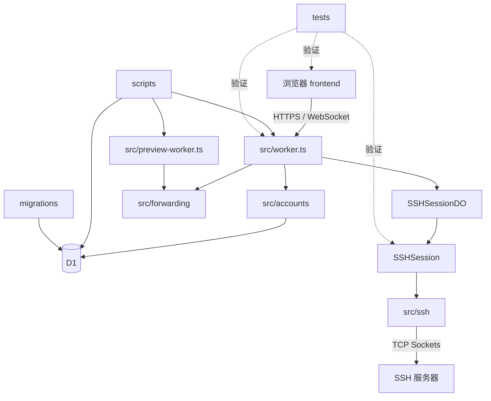

# EdgeSSH 架构总览

导航：[根索引](../../AGENTS.md)

EdgeSSH 是部署在用户 Cloudflare 账户内的单管理员 WebSSH 工作台。浏览器提供主机管理、终端、SFTP、进程监控、命令片段、设置同步与 HTTP 端口转发；Worker 负责认证和 API；Durable Object 通过 Cloudflare TCP Sockets 充当 SSH 客户端；D1 保存工作区数据。它不是多租户服务，也不是端到端加密网关。

项目使用根 `package.json` 管理前端、Worker、部署脚本与测试；不是 monorepo 工作区。TypeScript 严格检查，前端以原生 DOM 为主，文件列表局部使用 React/react-arborist，终端使用 xterm.js，构建使用 Vite。

## 模块导航

| 模块 | 说明 | 详细设计 |
| --- | --- | --- |
| `frontend/` | 浏览器工作台 | [前端](frontend.md) |
| `src/` | Worker 入口、共享类型与安全头 | [Worker](workers.md) |
| `src/accounts/` | 认证、工作区 API 与数据 | [账户与数据](accounts-and-data.md) |
| `src/backend/` | DO 与 SSH 会话 | [SSH 会话](ssh-sessions.md) |
| `src/ssh/` | SSH 与 SFTP 协议 | [协议实现](ssh-protocol.md) |
| `src/forwarding/` | HTTP 端口转发 | [转发](forwarding.md) |
| `migrations/` | D1 迁移 | [数据库](database.md) |
| `scripts/`、`.github/workflows/` | 部署与演示 | [部署](../development/deployment.md)、[工作流](../development/workflows.md) |
| `tests/` | 单元、协议与浏览器回归 | [测试](../development/testing.md) |

用户部署说明见根目录 [README](../../README.md) 与 [DEPLOYMENT](../../DEPLOYMENT.md)；Cloudflare Zero Trust 说明见 [ZERO_TRUST](../ZERO_TRUST.md)。
